# 工业缺陷生成模型 —— 全链路实现报告

---

## 目录

1. [数据集](#1-数据集)
2. [环境配置](#2-环境配置)
3. [模型架构](#3-模型架构)
4. [主模型代码](#4-主模型代码)
5. [生成结果](#5-生成结果)
6. [5 模型对比图](#6-5-模型对比图)
7. [实现过程](#7-实现过程)
8. [怎么做 —— 复现指南](#8-怎么做--复现指南)

---

## 1. 数据集

### 1.1 数据来源

原始数据来源于工业产线拍摄的大图（约 3000×3000），包含各类产品缺陷。通过 **YOLO 标注框 → 前景裁剪** 的处理流程，提取出 512×512 的缺陷切片。

### 1.2 数据预处理流程

```
data/ (YOLO标注原始大图, 3000×3000)
  │
  ├─ foreground_crop.py
  │   └─ 基于 YOLO 标注框裁剪前景 → 5% padding → 等比缩放至 512×512
  │      └─ data_foreground/ (class_1: 876张, class_4: 641张)
  │
  ├─ defect_patches_512_full/ (1806张, 缺陷类型 0/1/8/9)
  │
  └─ 合并 → defect_merged/ (3323张, 6种缺陷类型)
```

### 1.3 缺陷类型分布

| 类型 | 数量 | 占比 | 含义 | 来源 |
|------|------|------|------|------|
| type 0 | 219 | 6.6% | 产品表面缺陷 | 00_class_0 / 02_class_2 |
| type 1 | 329 | 9.9% | 产品表面缺陷 | 00_class_0 / 02_class_2 |
| type 8 | 303 | 9.1% | 产品表面缺陷 | 00_class_0 |
| type 9 | 796 | 23.9% | 产品表面缺陷 | 00_class_0 |
| type a (标签破洞) | 876 | 26.4% | 标签区域破损 | fg_class_1 |
| type b (颜色胶布) | 641 | 19.3% | 表面胶布残留 | fg_class_4 |
| **合计** | **3323** | **100%** | — | — |

### 1.4 数据集样本图示

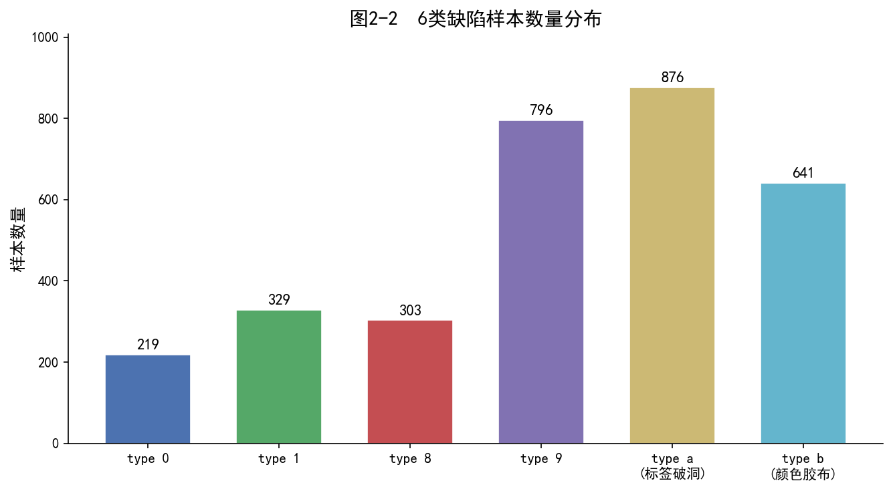
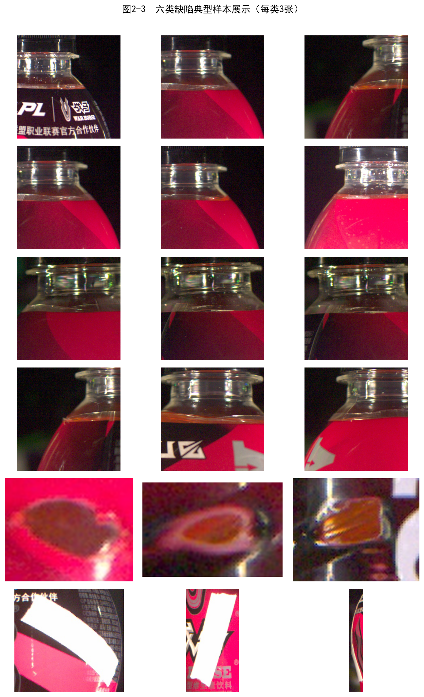

### 1.5 数据目录结构

```
defect_merged/
├── 00_class_0/           # 1687张, 类型 0/1/8/9
├── 02_class_2/           # 111张, 类型 0/1/8/9
├── 05_class_5/           # 8张, 类型 0/1
├── fg_class_1/           # 876张, 类型 a (标签破洞)
└── fg_class_4/           # 641张, 类型 b (颜色胶布)
```

---

## 2. 环境配置

### 2.1 硬件环境

| 设备 | 规格 |
|------|------|
| GPU | NVIDIA CUDA（11 GB+ 显存） |
| CPU | x86_64 |
| RAM | 16 GB+ |
| 磁盘 | SSD, 50 GB+ 可用空间 |

### 2.2 软件环境

| 软件 | 版本 |
|------|------|
| 操作系统 | Windows 11 |
| Python | 3.11 |
| CUDA | 11.8 |
| Conda 环境 | defectfill2 (`D:\conda_envs\defectfill2`) |

### 2.3 核心依赖

```
# 深度学习框架
torch>=2.0.0
torchvision>=0.15.0

# 扩散模型
diffusers>=0.12.0
transformers>=4.25.1
peft>=0.3.0
accelerate>=0.16.0

# 图像处理
opencv-python>=4.6.0
pillow>=9.0.0

# 数值计算
numpy>=1.24.0

# 工具
tqdm>=4.64.1
scipy>=1.10.0
```

### 2.4 Conda 环境安装命令

```powershell
# 创建环境
conda create -n defectfill2 python=3.11 -y
conda activate defectfill2

# 安装 PyTorch
pip install torch torchvision --index-url https://download.pytorch.org/whl/cu118

# 安装扩散模型库
pip install diffusers transformers accelerate peft

# 安装图像处理库
pip install opencv-python pillow numpy

# 安装辅助工具
pip install tqdm scipy matplotlib
```

---

## 3. 模型架构

### 3.1 SD+LoRA 架构图

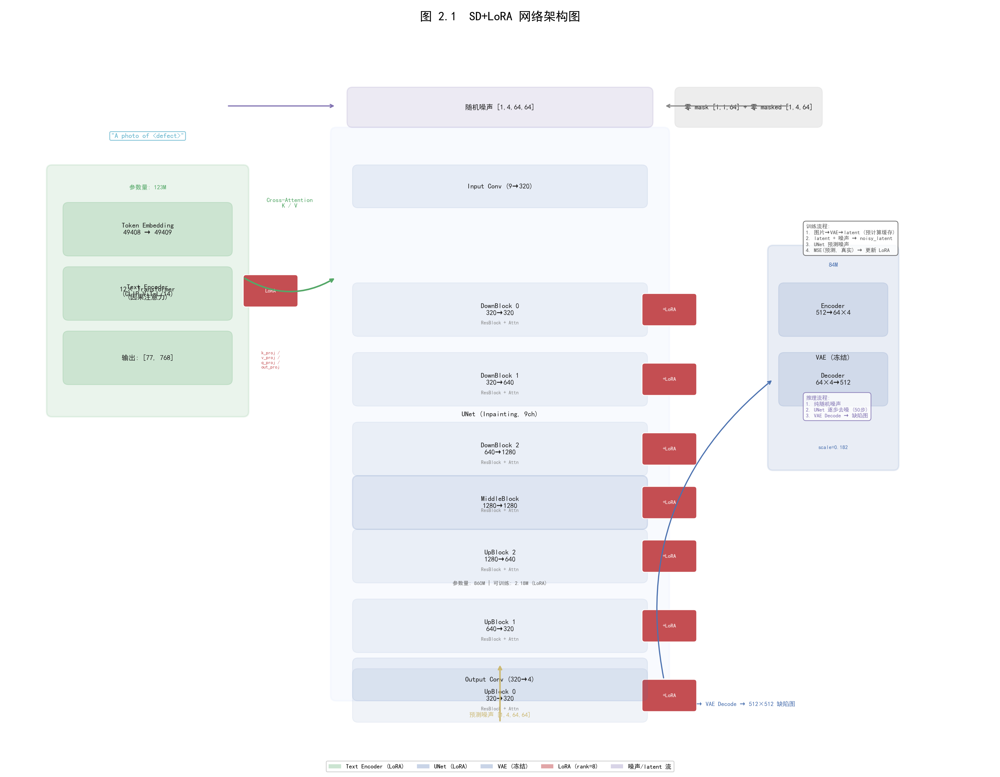

### 3.2 三大组件详解

#### 3.2.1 VAE（变分自编码器）

VAE 是图像与潜空间之间的桥梁，它将高维像素压缩到低维语义空间。

| 阶段 | 输入大小 | 输出大小 | 功能 |
|------|---------|---------|------|
| Encoder | 512×512×3 (RGB) | 64×64×4 (latent) | 下采样 8 倍，压缩比 48:1 |
| Decoder | 64×64×4 (latent) | 512×512×3 (RGB) | 上采样 8 倍还原图像 |

**关键参数**：
- 参数量：84M（冻结不训练）
- 缩放因子 `scaling_factor`：`0.18215`（使 latent 标准差接近 1）
- 编码输出为分布采样 `latent_dist.sample()`，非确定性 `mode()`

#### 3.2.2 UNet（核心去噪网络）

UNet 是扩散模型的"引擎"，负责根据当前噪声图像和时间步预测添加的噪声。

**UNet 结构**（纵向）：

```
Input (9ch) → Conv2d(9→320)
  ├─ DownBlock 0 (320→320, 2层)  → ResBlock + Transformer2D
  ├─ DownBlock 1 (320→640, 2层)  → ResBlock + Transformer2D
  ├─ DownBlock 2 (640→1280, 2层) → ResBlock + Transformer2D
  ├─ MiddleBlock (1280→1280, 1层) → ResBlock + Transformer2D
  ├─ UpBlock 2 (1280→640, 2层)    → (含 Skip Connection)
  ├─ UpBlock 1 (640→320, 2层)     → (含 Skip Connection)
  └─ UpBlock 0 (320→320, 2层)     → (含 Skip Connection)
       → Conv2d(320→4) → 输出噪声预测
```

**每个 Transformer2D 模块内部**：

```
LayerNorm → Self-Attention (to_q, to_k, to_v, to_out.0) ← LoRA
          → Cross-Attention (文本嵌入注入)               ← LoRA
          → Feed Forward Network
```

**9 通道输入说明**：
- 通道 0~3：`noisy_latent`（加噪后的 latent）
- 通道 4：`zero_mask`（全零，不使用 mask 信息）
- 通道 5~8：`zero_masked_image`（全零，不使用 masked image）

#### 3.2.3 Text Encoder（CLIP ViT-L/14）

将文本 prompt 编码为 UNet 可用的语义特征。

```
"A photo of <defect>"
  → Tokenizer (BPE, 49409 token)
  → CLIP Text Encoder (12层 Transformer, 因果注意力)
  → 输出 [77, 768] 维 text embedding
     (77 = 最大 token 长度, 768 = 隐藏层维度)
  → 传入 UNet Cross-Attention 作为 K 和 V
```

### 3.3 LoRA 低秩适配

**核心公式**：

```
全参数微调:     W' = W + ΔW            (参数量 = d × k)
LoRA 低秩分解:  W' = W + α/r × A × B   (参数量 = r × (d + k))
压缩比:         (d × k) / (r × (d + k)) ≈ 20 倍 (d=k=320, r=8)
```

**配置详情**：

| 模块 | 目标层 | LoRA rank | lora_alpha | 参数量 |
|------|--------|-----------|------------|--------|
| UNet | `to_k, to_q, to_v, to_out.0` | 8 | 8 | ~1.8M |
| Text Encoder | `k_proj, q_proj, v_proj, out_proj` | 8 | 8 | ~0.4M |
| **合计** | — | — | — | **~2.18M** |

---

## 4. 主模型代码

### 4.1 训练脚本 `train_defect_generator.py`

#### 整体流程

```
main()
  ├─ 解析参数 (epochs, lr, dataset_root, ...)
  ├─ 加载 Pipeline (仅用 VAE 做预计算)
  ├─ precompute_latents() → VAE 编码所有图片 → 缓存 latents_cache.pt → 释放 VAE
  ├─ 创建 DefectGeneratorTrainer (加载 Pipeline + LoRA + <defect> token)
  └─ trainer.train() → 训练循环
```

#### 核心类 `DefectGeneratorTrainer`

```python
class DefectGeneratorTrainer:
    def __init__(self, model_id, device="cuda", lora_rank=8):
        # 1. 加载基座模型
        self.pipe = StableDiffusionInpaintPipeline.from_pretrained(
            model_id, torch_dtype=torch.float16, safety_checker=None
        ).to(device)

        # 2. 配置 LoRA
        unet_lora_config = LoraConfig(
            r=lora_rank, lora_alpha=lora_rank,
            target_modules=["to_k", "to_q", "to_v", "to_out.0"],
            lora_dropout=0.0,
        )
        self.unet = get_peft_model(self.pipe.unet, unet_lora_config)

        te_lora_config = LoraConfig(
            r=lora_rank, lora_alpha=lora_rank,
            target_modules=["k_proj", "v_proj", "q_proj", "out_proj"],
            lora_dropout=0.0,
        )
        self.text_encoder = get_peft_model(self.pipe.text_encoder, te_lora_config)

        # 3. 冻结 VAE + Gradient Checkpointing
        self.vae.requires_grad_(False)
        self.unet.enable_gradient_checkpointing()

        # 4. 添加 <defect> token
        self.tokenizer.add_tokens(["<defect>"])
        self.text_encoder.resize_token_embeddings(len(self.tokenizer))

    def train_step(self, batch):
        """核心训练步骤：单步前向传播"""
        # 1. 获取预计算 latent + 生成噪声
        latents = batch['latent'].to(self.device)      # [1,4,64,64]
        noise = torch.randn_like(latents)               # ε ~ N(0,I)
        timesteps = torch.randint(0, 1000, (1,))        # t 随机采样

        # 2. 前向扩散: x_t = √ᾱ_t × x_0 + √(1-ᾱ_t) × ε
        noisy_latents = self.scheduler.add_noise(latents, noise, timesteps)

        # 3. 拼装 9 通道输入
        zero_mask = torch.zeros(1, 1, 64, 64)           # mask 填零
        zero_masked = torch.zeros(1, 4, 64, 64)        # masked 填零
        unet_input = torch.cat([noisy_latents, zero_mask, zero_masked], dim=1)

        # 4. Text embedding
        text_emb = self.get_text_embeddings("A photo of <defect>")

        # 5. UNet 预测噪声
        noise_pred = self.unet(unet_input, timesteps,
                               encoder_hidden_states=text_emb)

        # 6. MSE 损失
        loss = F.mse_loss(noise_pred, noise)
        return loss
```

#### Latent 预计算（加速关键）

```python
def precompute_latents(vae, dataset_root, ...):
    """一次性 VAE 编码所有图片，缓存到磁盘"""
    cache_path = os.path.join(cache_dir, "latents_cache.pt")

    if os.path.exists(cache_path):
        return torch.load(cache_path)   # 直接加载缓存

    for dtype, items in defect_groups.items():
        for item in items:
            img = imread_unicode(item['path'])
            img = cv2.resize(img, (512, 512))
            img_tensor = torch.from_numpy(img_rgb).float() / 127.5 - 1.0

            latent = vae.encode(img_tensor).latent_dist.sample()
            latent = latent * scaling_factor      # 缩放至 standard normal 尺度
            latents_list.append(latent.cpu())     # 放 CPU 内存

    torch.save(all_latents, cache_path)
```

### 4.2 推理脚本 `generate_per_type.py`

双模式推理：**txt2img**（纯噪声生成）和 **img2img**（基于参考图变异）。

```python
# txt2img: 从纯随机噪声生成
latents = torch.randn(num_samples, 4, 64, 64)     # 随机噪声
for t in timesteps:                                 # 50 步去噪
    unet_input = torch.cat([latents, mask, masked], dim=1)
    noise_pred = unet(unet_input, t, text_emb)
    latents = scheduler.step(noise_pred, t, latents)

# img2img: 基于参考图加噪再去噪
init_latents = vae.encode(reference_image)         # 编码参考图
init_latents = add_noise(init_latents, noise, t_start)  # 加噪
for t in timesteps[t_start:]:                       # 部分去噪
    unet_input = torch.cat([latents, mask, masked], dim=1)
    noise_pred = unet(unet_input, t, text_emb)
    latents = scheduler.step(noise_pred, t, latents)
```

---

## 5. 生成结果

### 5.1 txt2img 生成示例

从纯随机噪声生成的各类缺陷：


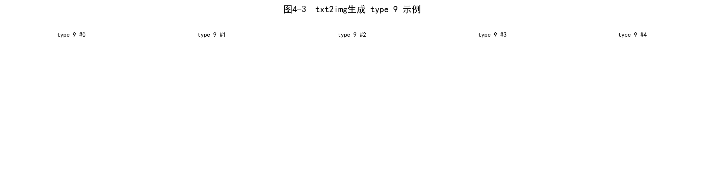

### 5.2 img2img 变异示例

基于参考图加噪再去噪，生成保留了部分结构的变体：

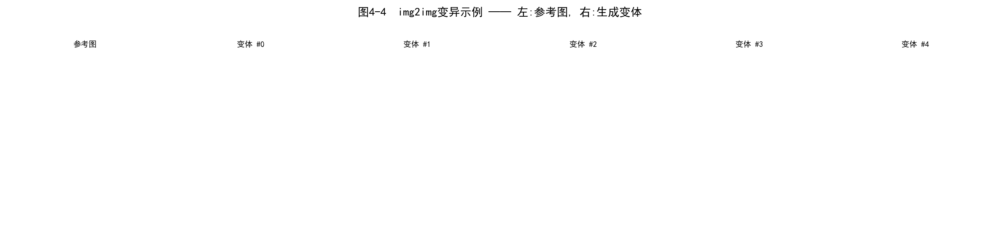

### 5.3 训练损失曲线

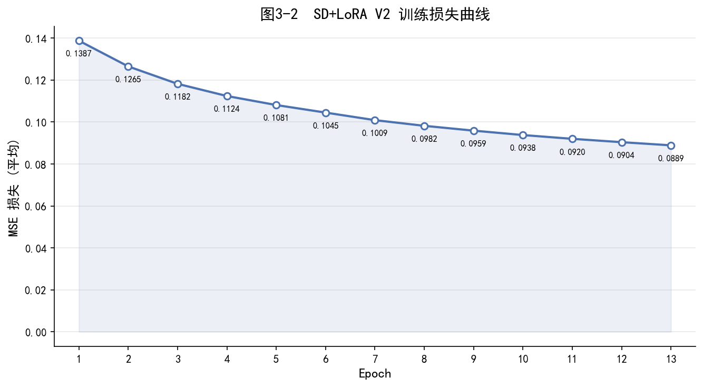

- 初始 loss：0.1387（Epoch 1）
- 最终 loss：0.0889（Epoch 13）
- 累计降幅：**35.9%**，仍在下降，未过拟合

### 5.4 速度优化对比

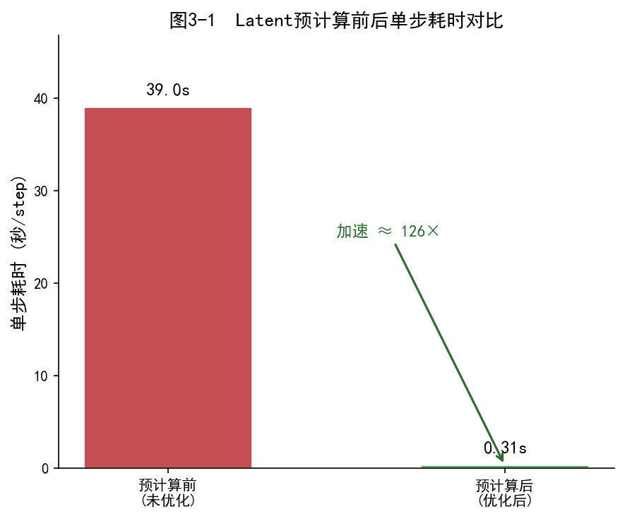

| 指标 | 预计算前 | 预计算后 | 加速比 |
|------|---------|---------|--------|
| 单步耗时 | ~39 s/step | ~0.31 s/step | **126×** |
| 每 epoch | ~19.5 小时 | ~17 分钟 | **69×** |
| GPU 显存 | ~13 GB | ~7 GB | **节省 46%** |

---

## 6. 5 模型对比图

### 6.1 五模型总览

| 序号 | 模型 | 目录 | 技术路线 | 基座模型 | 参数量 | 完成度 |
|------|------|------|---------|---------|--------|--------|
| **1** | **SD+LoRA (Inpainting)** | `test/` | SD Inpainting + LoRA + DreamBooth | 预训练 SD Inpainting (9ch) | 2.18M 可训练 | ⭐⭐⭐⭐⭐ |
| **2** | **SD+LoRA (Standard)** | `test/` | SD Standard + LoRA (9ch→4ch 转换) | 由 Inpainting 转换 (4ch) | 2.18M 可训练 | ⭐⭐⭐⭐ |
| **3** | **DDPM** | `4-28缺陷生成复现任务/` | 从零构建 DDPM | 自定义 UNet (从零训练) | ~15M 可训练 | ⭐⭐⭐ |
| **4** | **DefectFill** | `InpaintLoRA/DefectFillcore-main/` | SD Inpainting + LoRA + 注意力损失 | 预训练 SD Inpainting | ~2.2M 可训练 | ⭐⭐⭐⭐ |
| **5** | **Pix2Pix** | `pix2pix/` | 条件 GAN (UNet + PatchGAN) | 从零构建 | ~54M 可训练 | ⭐⭐⭐⭐ |

### 6.2 六维指标雷达图

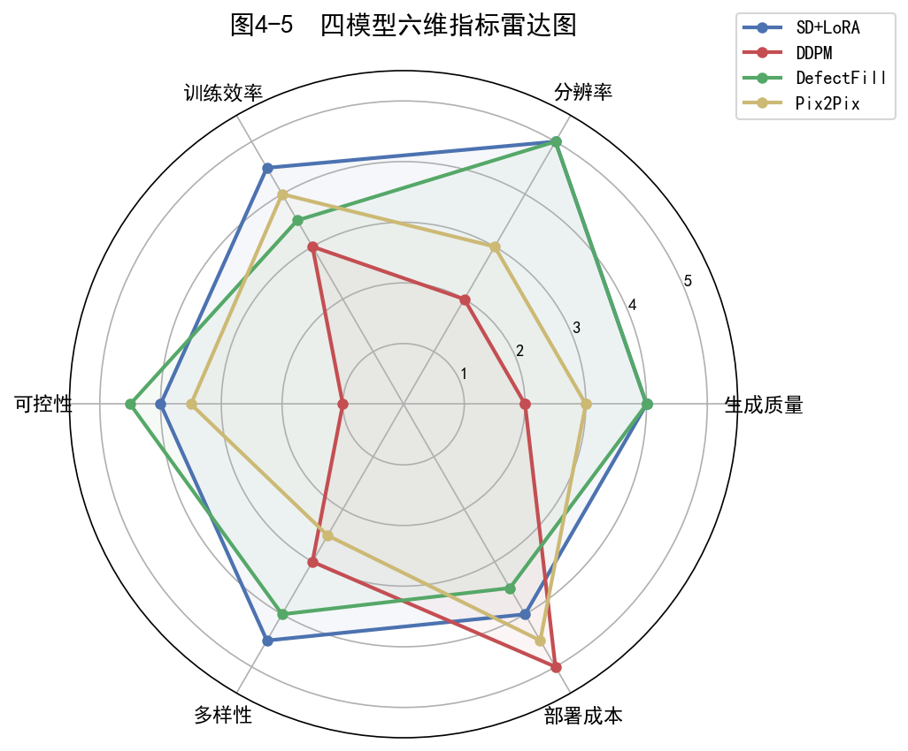

| 指标 | SD+LoRA | DDPM | DefectFill | Pix2Pix |
|------|---------|------|------------|---------|
| **生成质量** | 4.0 | 2.0 | 4.0 | 3.0 |
| **分辨率** | **5.0** (512×512) | 2.0 (32×32) | **5.0** (512×512) | 3.0 (256×256) |
| **训练效率** | 4.5 | 3.0 | 3.5 | 4.0 |
| **可控性** | 4.0 | 1.0 | **4.5** | 3.5 |
| **多样性** | **4.5** | 3.0 | 4.0 | 2.5 |
| **部署成本** | 4.0 | **5.0** | 3.5 | **4.5** |

### 6.3 生成结果并排对比

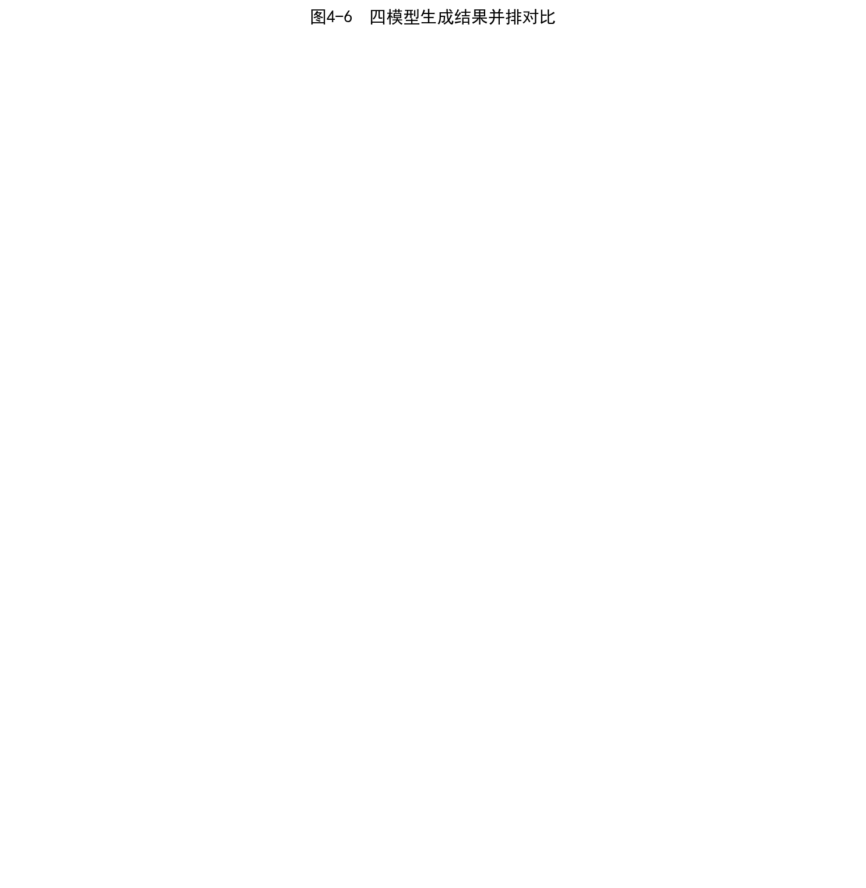

### 6.4 详细对比表

| 维度 | SD+LoRA (Inpainting) | SD+LoRA (Standard) | DDPM | DefectFill | Pix2Pix |
|------|---------------------|-------------------|------|------------|---------|
| **输入** | 9ch (noise+mask+masked) | 4ch (纯噪声) | 4ch (纯噪声) | 9ch (noise+mask+masked) | 3ch (正常图) |
| **推理方式** | txt2img + img2img | txt2img | 纯噪声 → 图像 | inpainting | 条件图 → 图像 |
| **推理步数** | 50 (DDIM) | 50 (DDIM) | **1000** | 50 (DDIM) | **1** (前向) |
| **推理速度** | ~5 s/张 | ~5 s/张 | ~30 s/张 | ~5 s/张 | **< 0.1 s/张** |
| **数据集要求** | 低 (几百张) | 低 (几百张) | 中 (几千张) | 低 (需掩码) | 高 (需配对) |
| **缺陷可控性** | prompt 控制类型 | prompt 控制类型 | ❌ 不可控 | mask+prompt | 条件图控制 |
| **显存需求** | ~7 GB | ~7 GB | ~4 GB | ~10 GB | ~2 GB |
| **主要瓶颈** | txt2img 质量有限 | 转换后质量略降 | 分辨率 32×32 太低 | 训练复杂度高 | 需配对数据 |

---

## 7. 实现过程

### 7.1 阶段一：数据准备


**关键实现**：
```python
# foreground_crop.py 核心逻辑
for each image with YOLO labels:
    x1 = max(0, cx - w/2 * 1.05)    # 5% padding
    y1 = max(0, cy - h/2 * 1.05)
    x2 = min(W, cx + w/2 * 1.05)
    y2 = min(H, cy + h/2 * 1.05)
    crop = img[y1:y2, x1:x2]         # 裁剪
    crop = cv2.resize(crop, (512, 512))  # 缩放至 512×512
```

### 7.2 阶段二：模型训练


**训练命令**：
```powershell
# 新训
python train_defect_generator.py ^
    --dataset_root defect_merged ^
    --epochs 30 --lr 1e-4

# 续训
python train_defect_generator.py ^
    --dataset_root defect_merged ^
    --epochs 30 --lr 1e-4 ^
    --resume_from defect_generator_checkpoints_v2\checkpoint_epoch_13
```

**关键性能指标**：

| 优化项 | 优化前 | 优化后 | 提升 |
|--------|--------|--------|------|
| 单步耗时 | 39s/step | 0.31s/step | **126×** |
| 每 epoch | 19.5 小时 | 17 分钟 | **69×** |
| GPU 显存 | 13 GB | 7 GB | **46%** |
| 数据量 | 1806 张 | 3323 张 | **+84%** |
| 缺陷类型 | 4 种 | 6 种 | **+2 种** |

### 7.3 阶段三：推理生成

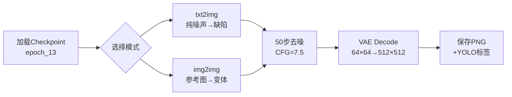

**推理命令**：
```powershell
# txt2img + img2img 双模式
python generate_per_type.py ^
    --mode both --per_type 5 ^
    --checkpoint_dir defect_generator_checkpoints_v2\checkpoint_epoch_6

# 仅 txt2img（标准 4ch UNet）
python generate_std_txt2img.py ^
    --per_type 5 ^
    --checkpoint_dir defect_generator_checkpoints_v2\checkpoint_epoch_6

# fg_class_4 专用 img2img
python infer_fg_class4.py ^
    --ref_count 5 --num_samples 20
```

### 7.4 阶段四：结果分析与可视化

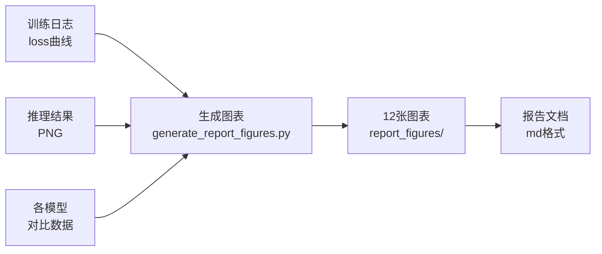

---

## 8. 怎么做 —— 复现指南

### 8.1 快速开始（30 分钟）

从已有 checkpoint 直接推理生成缺陷图：

```powershell
# 1. 激活环境
conda activate defectfill2

# 2. txt2img 生成（6类 × 5张 = 30张）
python generate_per_type.py --mode txt2img --per_type 5

# 3. img2img 生成（基于参考图变异）
python generate_per_type.py --mode img2img --per_type 5 --strength 0.85

# 输出在: defectfill_output/variations_v2/txt2img/ 和 img2img/
```

### 8.2 完整复现（3 天）

#### 第 1 天：数据准备

```powershell
# 1. 确保 defect_merged/ 目录存在，包含 3323 张缺陷切片
#    或从原始数据重新裁剪：
python foreground_crop.py --input_dir data --output_dir data_foreground

# 2. 检查数据分布
ls defect_merged/*/ | select Name, @{N="Count";E={@(Get-ChildItem $_.FullName -Filter *.png).Count}}
```

#### 第 2 天：模型训练

```powershell
# 1. 首次训练（自动预计算 latent，约 2 分钟）
python train_defect_generator.py ^
    --dataset_root defect_merged ^
    --epochs 30 --lr 1e-4

# 2. 如果已有缓存，也可续训
python train_defect_generator.py ^
    --dataset_root defect_merged ^
    --epochs 30 --lr 1e-4 ^
    --resume_from defect_generator_checkpoints_v2\checkpoint_epoch_13
```

**预期训练进度**：
| Epoch | 累计时间 | Loss | 说明 |
|-------|---------|------|------|
| 1 | 17 min | 0.1387 | 初始 |
| 5 | 1.4 h | 0.1081 | 快速下降期 |
| 10 | 2.8 h | 0.0938 | 稳定下降期 |
| 13 | 3.7 h | 0.0889 | 继续下降中 |

#### 第 3 天：推理 + 报告

```powershell
# 1. 生成所有类型的缺陷图
python generate_per_type.py --mode both --per_type 10

# 2. 生成报告图表
python generate_report_figures.py

# 3. 生成架构图
python draw_architecture.py

# 4. 查看结果
#    - 推理结果: defectfill_output/variations_v2/
#    - 报告图表: report_figures/*.png
```

### 8.3 参数调优指南

| 参数 | 默认值 | 调优范围 | 说明 |
|------|--------|---------|------|
| `--epochs` | 30 | 20~50 | 更多 epoch 通常更好，监控 loss 是否收敛 |
| `--lr` | 1e-4 | 5e-5~5e-4 | AdamW，LoRA 用小学习率 |
| `--lora_rank` | 8 | 4~32 | rank 越大表现力越强，但更容易过拟合 |
| `--strength` | 0.85 | 0.6~0.95 | img2img 噪声强度，越大变异越大 |
| `--guidance` | 7.5 | 5~15 | CFG 引导强度，越大越遵循 prompt |
| `--steps` | 50 | 20~100 | 推理步数，越多越精细但越慢 |

### 8.4 常见问题

**Q: 训练时显存不足？**
- 确保 VAE 预计算完成后被释放（`del pipe` + `torch.cuda.empty_cache()`）
- 尝试 `--lora_rank 4` 减少 LoRA 参数量

**Q: 生成质量不佳？**
- 检查 checkpoint 是否使用最新的 epoch
- 增大 `--guidance` 到 10~12 增强 prompt 遵循度
- 增大 `--steps` 到 100 提高生成精细度

**Q: 中文路径报错？**
- 脚本已内置 `imread_unicode` 和 `imwrite_unicode` 支持中文路径
- 确保 Python 文件编码为 UTF-8

**Q: 断点续训失败？**
- 使用 `--resume_from` 指向 checkpoint 目录
- 脚本使用 `safetensors.torch.load_file` 绕过 peft 路径校验
- Windows 路径含中文或反斜杠时此方法可靠

**Q: 输出文件为空？**
- 检查输出目录权限
- 推理时添加 `flush=True` 确保实时打印日志
- 检查 `--output_dir` 参数是否正确

---

## 附录：项目文件索引

| 文件 | 功能 | 大小 |
|------|------|------|
| `train_defect_generator.py` | 训练脚本（核心） | 607 行 |
| `generate_per_type.py` | 推理脚本（txt2img + img2img） | 338 行 |
| `generate_std_txt2img.py` | 标准 4ch UNet 推理 | 201 行 |
| `infer_fg_class4.py` | fg_class_4 专用 img2img | 222 行 |
| `foreground_crop.py` | 前景裁剪预处理 | ~200 行 |
| `generate_report_figures.py` | 报告图表生成 | 475 行 |
| `draw_architecture.py` | 网络架构图绘制 | 237 行 |
| `generate_variations.py` | img2img 变体生成（旧版） | 248 行 |

### 输出目录结构

```
report_figures/           # 12 张报告图表
  ├─ fig2_1_sd_lora_architecture.png
  ├─ fig2_1_foreground_crop.png
  ├─ fig2_2_type_distribution.png
  ├─ fig2_3_sample_grid.png
  ├─ fig3_1_speed_comparison.png
  ├─ fig3_2_loss_curve.png
  ├─ fig4_1~4_4_txt2img/img2img示例
  ├─ fig4_5_radar.png
  └─ fig4_6_comparison.png

defectfill_output/         # 推理输出
  └─ variations_v2/
      ├─ txt2img/images/   # 纯噪声生成
      └─ img2img/images/   # 参考图变异

defect_generator_checkpoints_v2/  # 训练 checkpoint (13 epoch)
  ├─ checkpoint_epoch_1~13/
  │   ├─ unet/adapter_model.safetensors    # UNet LoRA (~5MB)
  │   ├─ text_encoder/adapter_model...     # TE LoRA (~2MB)
  │   └─ training_state.pt                # 优化器状态
  └─ latents_cache.pt                     # 预计算 latent (~100MB)
```

---

*文档生成日期：2026-06-15*
